# SCOBO: Autonomous Nursing Robot

SCOBO is a ward robot that does the routine bedside work between nurse rounds. It drives to each bed on a schedule, checks the patient's temperature, pulse and SpO2, hands out medicine from three pill hoppers and lets staff video call the patient. Nurses and doctors plan the work and read the results on a ward website.

<p align="center">
  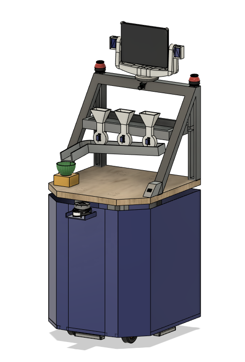
  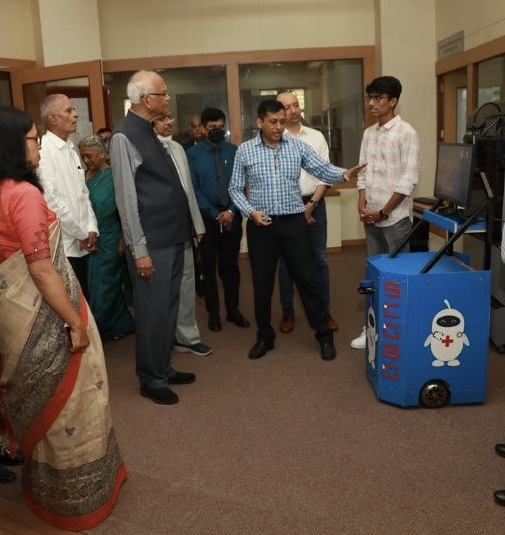
</p>

The software runs on ROS 2 Humble with Nav2. Everything can be tried in a Gazebo ward with eight beds and simulated patients, and the same packages run on the real robot with a Jetson Nano and an Arduino Mega.

## Contents

- [What it does](#what-it-does)
- [Hardware](#hardware)
- [Software](#software)
- [Repository layout](#repository-layout)
- [Simulation](#simulation)
- [Ward website](#ward-website)
- [Real robot](#real-robot)
- [License](#license)

## What it does

- **Ward rounds on a schedule.** Tasks due in the same 15 minute window go into one trip. The robot visits the beds in ward order, then returns home.
- **Temperature.** An MLX90640 thermal camera looks at the patient's face. The frames are averaged and the hottest pixels give the skin temperature.
- **Pulse and SpO2.** The patient places a finger on a MAX30102 at the front of the robot.
- **Medicine.** Three servo-driven hoppers drop the pills into a glass bowl and the patient taps *Collected* on the tablet.
- **Tablet display.** An iPad on a pan-tilt head greets the patient and guides each step.
- **Video call.** Staff can call the robot from the website over WebRTC.
- **Ward website.** Admit and discharge patients, plan tasks, give medicine now, watch the robot live on the ward map and read every visit and reading.
- **Safe driving.** The lidar and two ultrasonic sensors feed the costmaps and a collision monitor, so low obstacles the lidar misses still stop the robot.

## Hardware

| Part | Model | Connected to |
|---|---|---|
| Main computer | NVIDIA Jetson Nano 4 GB | |
| Microcontroller | Arduino Mega 2560 | Jetson, USB |
| Lidar | RPLidar A1 | Jetson, USB |
| Thermal camera | MLX90640, 55 x 35 deg | Jetson I2C (pins 3 and 5) |
| Drive | 4 x PG36M555 DC motors with hall encoders, skid steer | Mega |
| Motor drivers | 2 x Cytron MDD10A | Mega |
| IMU | BNO055 | Mega I2C |
| Pulse oximeter | MAX30102 | Mega I2C |
| Ultrasonic | 2 x HC-SR04, front and rear | Mega |
| Display | iPad on a pan-tilt head | Wi-Fi |
| Pan | NEMA 17 stepper with an A4988 driver and a home switch | Mega |
| Tilt | 2 x MG995 servos | Mega |
| Pill hoppers | 3 x SG30 servos | Mega |
| Power | 24 V battery with an emergency stop | |

The CAD model is in [`cad/scobo/scobo_final.step`](cad/scobo/scobo_final.step) (Fusion 360 archive [`scobo_final.f3z`](cad/scobo/scobo_final.f3z)). The earlier versions in the same folder show how the body and the upper half developed.

<p align="center">
  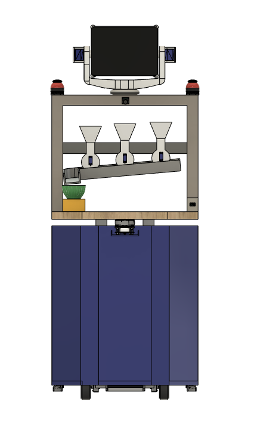
  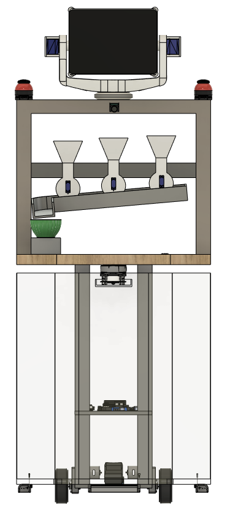
</p>

## Software

| Package | What it holds |
|---|---|
| `scobo_description` | URDF with the sensor frames and the pan-tilt joints, COLLADA meshes exported from the CAD |
| `scobo_gazebo` | Ward world, simulated patients, the simulated sensors and the sim launch file |
| `scobo_navigation` | slam_toolbox mapping, AMCL, Nav2, the EKF, wheel odometry, gyro bias removal, the ward map and the bed stops |
| `scobo_interfaces` | Messages and services for the ward plan, visits, display and pill dispenser |
| `scobo_tasks` | Task manager: the ward plan, the trips and every bed visit, stored in SQLite |
| `scobo_display` | Tablet page served by the robot and rosbridge |
| `scobo_web` | Link to the ward website: pulls the plan, pushes the visits and publishes the robot pose |
| `scobo_hardware` | Real robot nodes: the Mega link, the MLX90640 driver and the lidar scan crop |
| `scobo_bringup` | Real robot launch files |

**Navigation.** Wheel odometry and the BNO055 gyro are fused in a robot_localization EKF. AMCL localises on the saved map. Nav2 plans with Smac 2D and drives with a Rotation Shim in front of Regulated Pure Pursuit, through a velocity smoother and a collision monitor. The ultrasonic sensors reach the costmaps through the range sensor layer.

**A bed visit.** At each bed the task manager shows a greeting, takes the pulse oximeter reading, then the temperature, then drops the medicine and waits for the *Collected* tap. The visit is stored with any problems (no finger, no face seen, hopper empty, not collected) and sent to the website.

<p align="center">
  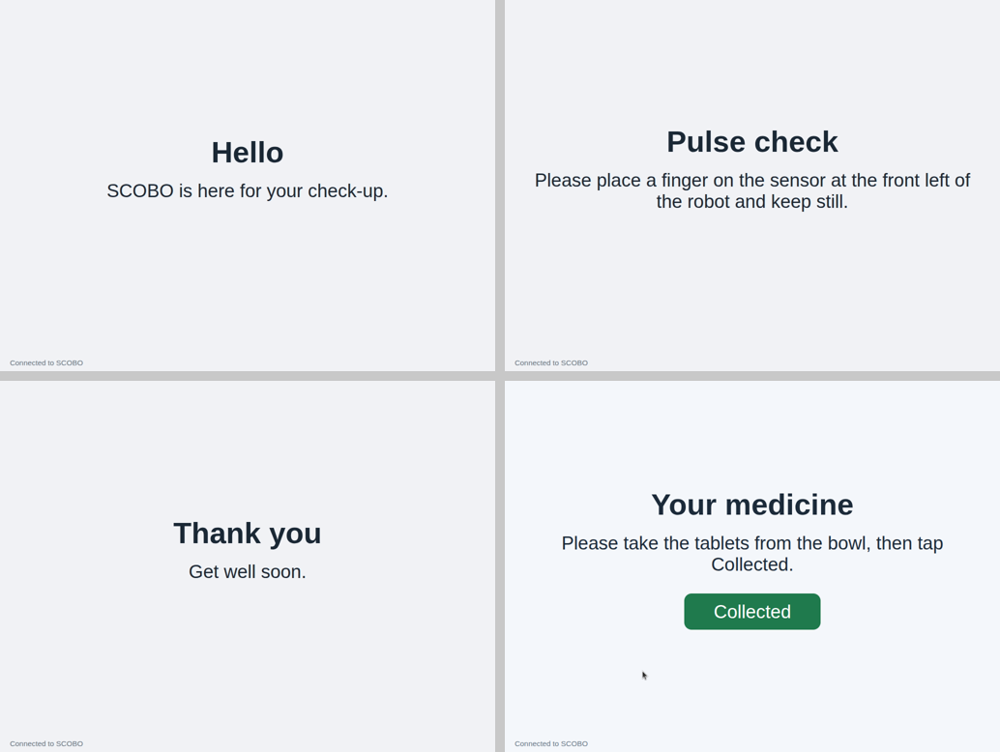
  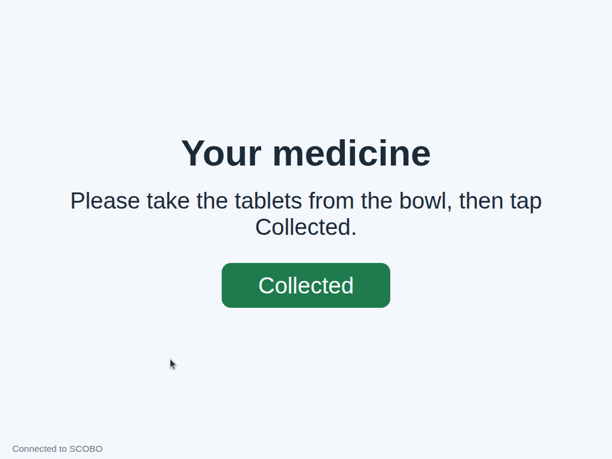
</p>

## Repository layout

```
cad/          CAD models, renders and a photo of the robot
diagrams/     Block diagrams from the design stage
docs/         Pictures and videos of the simulation and the website
firmware/     Arduino Mega firmware
ros2_ws/src/  ROS 2 packages
website/      Ward website
```

## Simulation

### Install

Ubuntu 22.04 with [ROS 2 Humble](https://docs.ros.org/en/humble/Installation/Ubuntu-Install-Debs.html) (desktop) and Gazebo Classic 11.

```bash
sudo apt install ros-humble-desktop ros-dev-tools
sudo rosdep init   # once per machine
rosdep update

git clone https://github.com/Patil-Vinay/Autonomous-Nursing-Robot.git
cd Autonomous-Nursing-Robot/ros2_ws
source /opt/ros/humble/setup.bash
rosdep install --from-paths src --ignore-src -y
colcon build --symlink-install
source install/setup.bash
```

Every terminal below needs `source install/setup.bash` from `ros2_ws`.

### Look at the robot

```bash
ros2 launch scobo_description display.launch.py
```

### Map the ward

```bash
ros2 launch scobo_gazebo sim.launch.py rviz:=false
ros2 launch scobo_navigation mapping.launch.py use_sim_time:=true
ros2 run teleop_twist_keyboard teleop_twist_keyboard
```

Drive round the ward, then save the map and the slam_toolbox session:

```bash
ros2 run nav2_map_server map_saver_cli -f src/scobo_navigation/maps/ward --ros-args -p free_thresh_default:=0.196
ros2 service call /slam_toolbox/serialize_map slam_toolbox/srv/SerializePoseGraph "{filename: 'src/scobo_navigation/maps/ward'}"
```

A map of the sim ward is already in `scobo_navigation/maps`.

<p align="center">
  <a href="docs/videos/slam_mapping_rviz.mp4">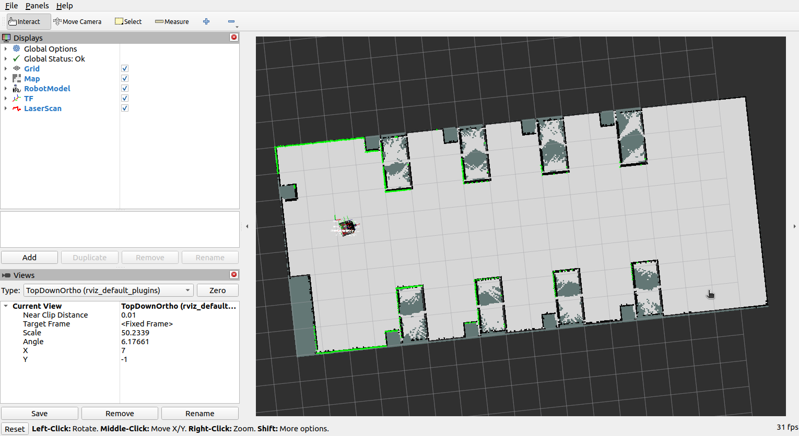</a>
  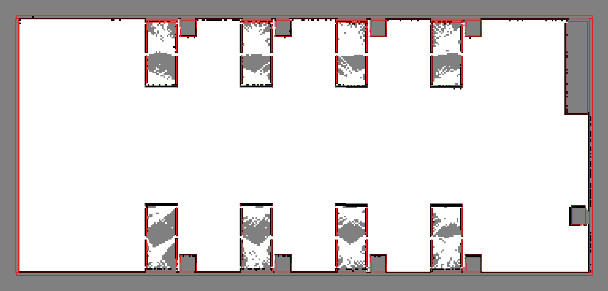
</p>

### Navigate

```bash
ros2 launch scobo_gazebo sim.launch.py rviz:=false
ros2 launch scobo_navigation navigation.launch.py use_sim_time:=true
```

Send goals with *Nav2 Goal* in RViz, or drive to the bed stops in `config/beds.yaml`:

```bash
ros2 run scobo_navigation go_to_bed 3 --ros-args -p use_sim_time:=true
ros2 run scobo_navigation go_to_bed all --ros-args -p use_sim_time:=true
```

| | |
|---|---|
| [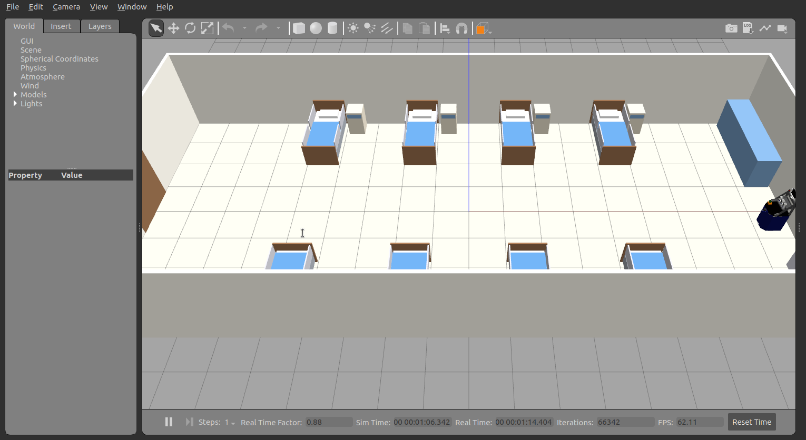](docs/videos/nav2_goals_gazebo.mp4) | [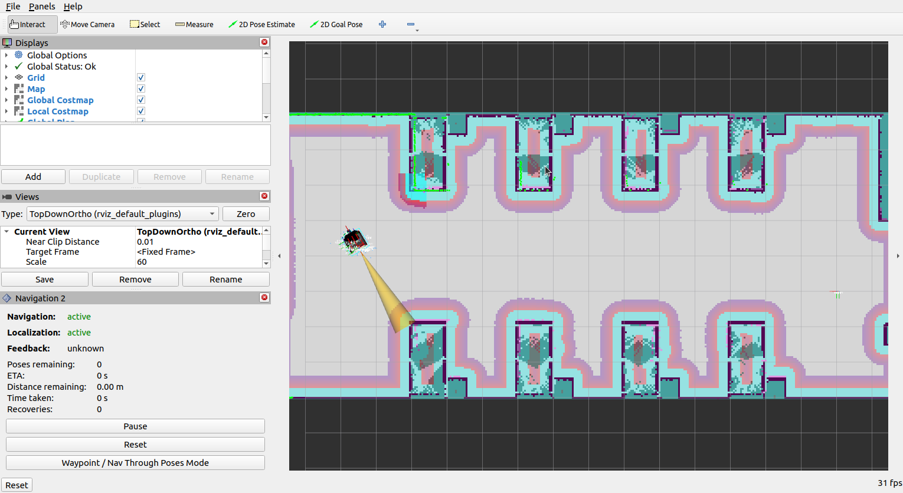](docs/videos/nav2_goals_rviz.mp4) |
| [Nav2 goals in Gazebo](docs/videos/nav2_goals_gazebo.mp4) | [Nav2 goals in RViz](docs/videos/nav2_goals_rviz.mp4) |
| [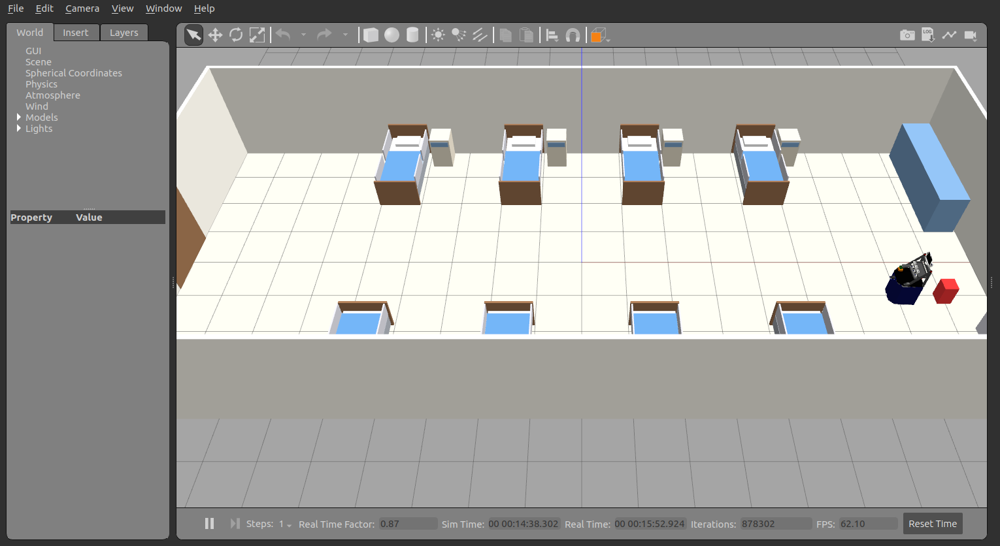](docs/videos/collision_monitor_gazebo.mp4) | [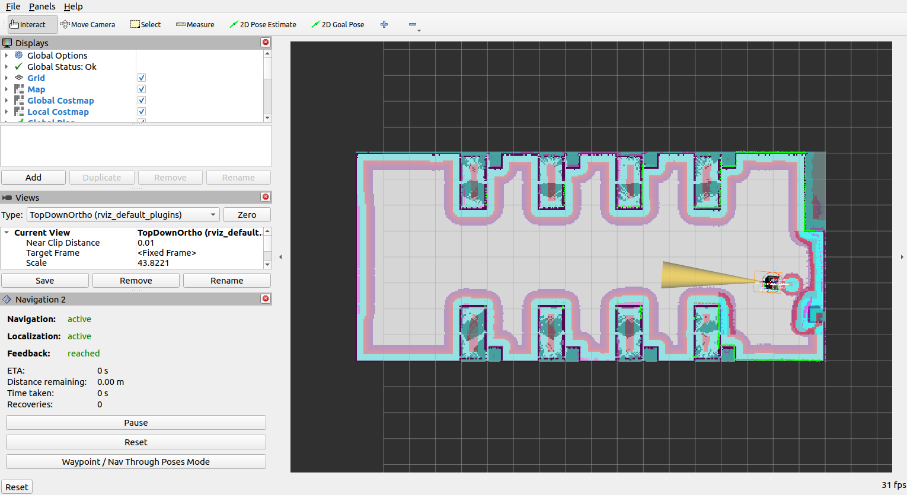](docs/videos/collision_monitor_rviz.mp4) |
| [Collision monitor in Gazebo](docs/videos/collision_monitor_gazebo.mp4) | [Collision monitor in RViz](docs/videos/collision_monitor_rviz.mp4) |

### Ward round with patients

The sim has seven patients (bed 6 is empty) with their own temperature, pulse and SpO2 in `scobo_gazebo/config/patients.yaml`. The thermal camera, pulse oximeter and pill dispenser are simulated.

```bash
ros2 launch scobo_gazebo sim.launch.py rviz:=false
ros2 launch scobo_navigation navigation.launch.py use_sim_time:=true
ros2 launch scobo_tasks tasks.launch.py use_sim_time:=true
```

Open the tablet page at <http://localhost:8080>, send the plan in `scobo_tasks/config/ward_plan.yaml` and start a round:

```bash
ros2 run scobo_tasks send_plan
ros2 service call /ward/run_now std_srvs/srv/Trigger
```

Other task manager commands:

```bash
ros2 service call /ward/go_to scobo_interfaces/srv/GoTo "{bed: 3}"   # drive to bed 3 and wait there
ros2 service call /ward/stop std_srvs/srv/Trigger                  # stop and end the trip
```

<p align="center">
  <a href="docs/videos/patients_round_gazebo.mp4">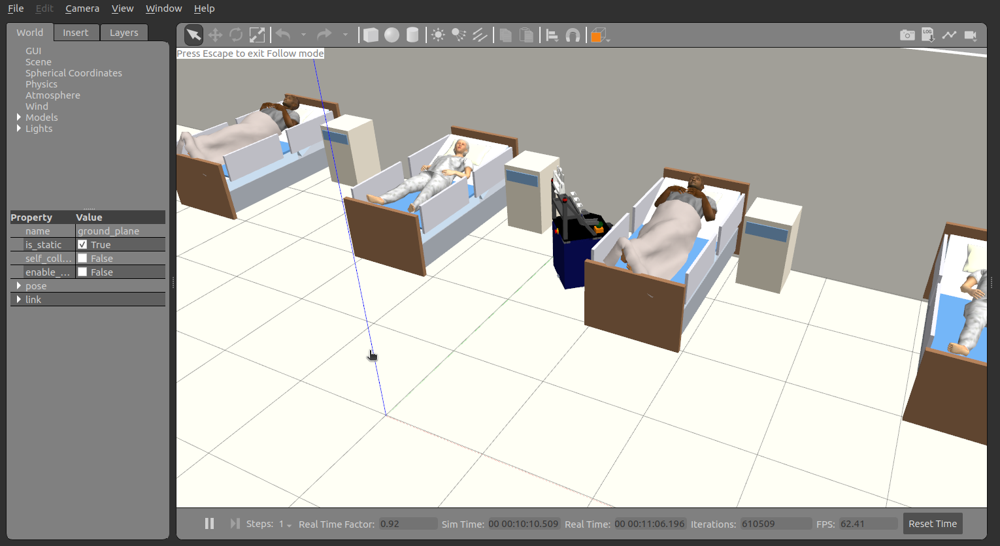</a>
  <a href="docs/videos/patients_round_rviz.mp4">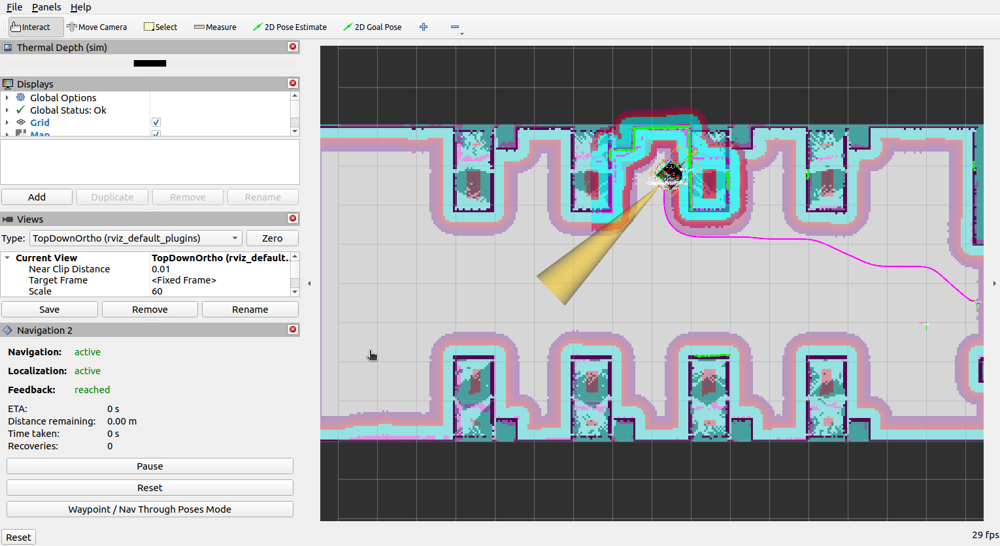</a>
</p>

Videos: [patient round in Gazebo](docs/videos/patients_round_gazebo.mp4), [patient round in RViz](docs/videos/patients_round_rviz.mp4).

## Ward website

```bash
cd website
python3 -m venv .venv
source .venv/bin/activate
pip install -r requirements.txt
python manage.py migrate
python manage.py seed_ward          # the sim ward: 8 beds, 3 hoppers, patients and the plan
python manage.py createsuperuser
python manage.py runserver
```

Open <http://localhost:8000>. Staff accounts are made in the admin panel at `/admin` and put in the **Nurse** or **Doctor** group.

| Page | Nurse | Doctor |
|---|---|---|
| Dashboard, patients, patient records with charts, visits log | yes | yes |
| Robot: live map, last visit, next task | yes | yes |
| Robot: send it to a bed, stop it | yes | |
| Video call | yes | yes |
| Ward: admit and discharge | yes | |
| Schedule: tasks, give medicine now, pill hoppers | yes | |

<p align="center">
  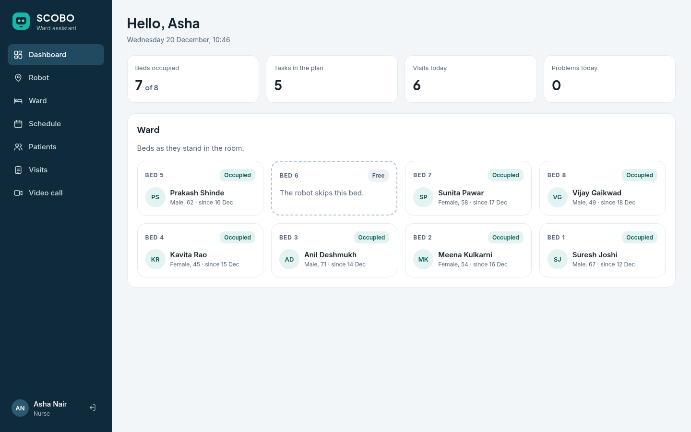
  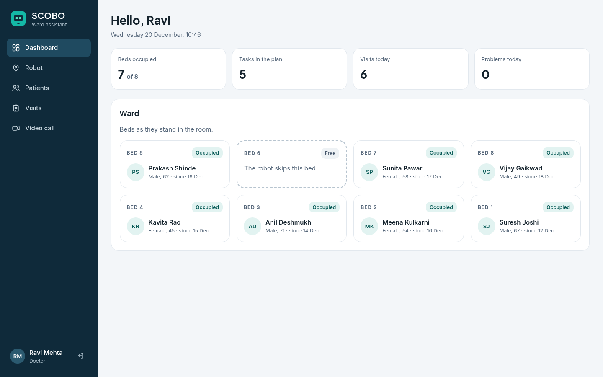
</p>

**Connect the robot.** With the website running, start the link on the robot side. It pulls the plan every 5 s and sends new visits every 10 s.

```bash
ros2 launch scobo_web web.launch.py use_sim_time:=true site_url:=http://localhost:8000 token:=dev-robot-token
```

On a real host set these before starting the site:

| Variable | Meaning |
|---|---|
| `SCOBO_SECRET_KEY` | Secret key |
| `SCOBO_DEBUG` | `0` |
| `SCOBO_HOSTS` | Host names of the site, comma separated |
| `SCOBO_ROBOT_TOKEN` | Robot token, the same as the `token` launch argument |
| `SCOBO_ROBOT_WS` | Robot's rosbridge, e.g. `ws://192.168.1.112:9090` |

<p align="center">
  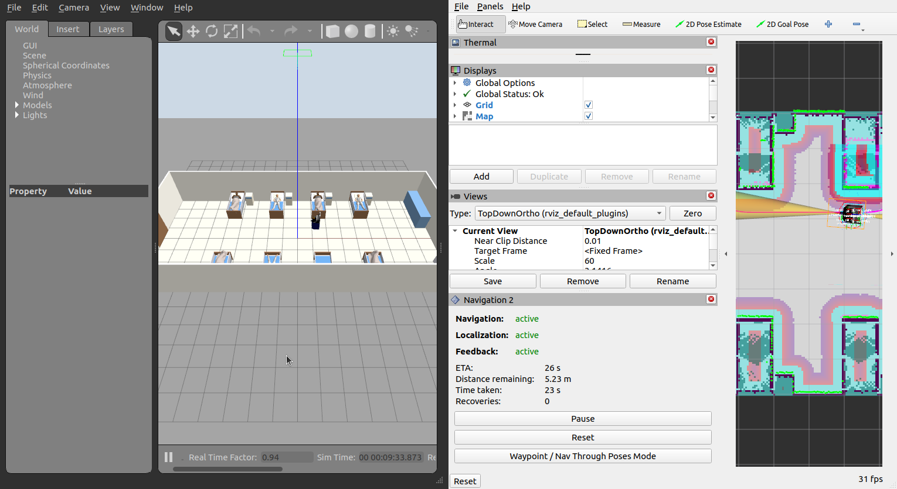
</p>

## Real robot

### Mega firmware

[`firmware/scobo_mega/scobo_mega.ino`](firmware/scobo_mega/scobo_mega.ino) runs the wheel speed loops, the pan-tilt, the pill hoppers and the sensors on the Mega. Open it in the Arduino IDE, install **AccelStepper** (1.64) and the **SparkFun MAX3010x Pulse and Proximity Sensor Library** (1.1.2) from the Library Manager, select *Arduino Mega or Mega 2560* and upload.

| Part | Mega pins |
|---|---|
| MDD10A 1 (front left, rear left) | PWM 5, 6, DIR 22, 23 |
| MDD10A 2 (front right, rear right) | PWM 7, 8, DIR 24, 25 |
| Encoders, channel A (FL, RL, FR, RR) | 2, 3, 18, 19 |
| Encoders, channel B | 26, 27, 28, 29 |
| BNO055 and MAX30102 | SDA 20, SCL 21 |
| Tilt servos (left, right) | 9, 10 |
| Hopper servos 1 to 3 | 11, 12, 44 |
| A4988 pan stepper | STEP 30, DIR 31, EN 32 |
| Pan home switch (to GND) | 33 |
| HC-SR04 rear | TRIG 34, ECHO A8 |
| HC-SR04 front | TRIG 36, ECHO A9 |

The servos need their own 5-6 V supply with a common ground. The MAX30102 board needs a 3.3 V level shifter on the I2C lines.

The Mega talks to the Jetson at 250000 baud in text lines with an NMEA style checksum, e.g. `$V 800 800 800 800*1C`:

| Direction | Line | Meaning |
|---|---|---|
| To the Mega | `V fl rl fr rr` | Wheel speeds, encoder counts per second |
| | `P pan tilt` | Pan and tilt angles, mrad |
| | `D hopper count` | Drop pills |
| From the Mega | `E ms fl rl fr rr pan tilt` | Encoder counts and pan-tilt angles, 50 Hz |
| | `I ax ay az gx gy gz qw qx qy qz` | Raw BNO055 readings, 50 Hz |
| | `R r\|f mm` | Rear or front range, 0 for no echo, 10 Hz each |
| | `X finger valid hr spo2` | Pulse oximeter, 1 Hz |
| | `S homed imu ox calib` | Status, 1 Hz |
| | `D hopper count` | Pills dropped |

The wheels stop if no `V` line arrives for 0.5 s.

### Jetson Nano

The Jetson Nano runs JetPack 4.6 (Ubuntu 18.04, Python 3.6), and ROS 2 Humble has no packages for it. SCOBO runs Humble in Docker on top of `dustynv/ros:humble-ros-base-l4t-r32.7.1`, with these built from source: Nav2 1.1.12, slam_toolbox 2.6.6, robot_localization 3.5.1, rosbridge 1.3.2 and rplidar_ros 2.1.4, then this workspace without `scobo_gazebo`. On Ubuntu 18.04 the packages are built with GCC 8 and `smbus2` 0.4.3 comes from pip. On a computer with Ubuntu 22.04 the same packages install from apt as in [Install](#install).

The container needs:

- the host network, for ROS 2 discovery, rosbridge on 9090 and the tablet page on 8080
- `/dev`, for the lidar, the Mega and `/dev/i2c-1`
- `/maps` for the ward map and `/root/.ros/scobo` for the task manager's database, both kept outside the container

### Launch

```bash
# drivers, odometry and the EKF
ros2 launch scobo_bringup robot.launch.py mega_port:=/dev/ttyACM0 lidar_port:=/dev/ttyUSB0

# map the ward, then save the map to /maps/ward
ros2 launch scobo_bringup mapping.launch.py

# the robot on its rounds: Nav2, tasks, tablet page and the website link
ros2 launch scobo_bringup ward.launch.py map:=/maps/ward.yaml site_url:=http://<website>:8000 token:=<robot token>
```

The tablet opens `http://<robot>:8080`. RViz can run on another computer on the same network with the same `ROS_DOMAIN_ID`.

### Calibration

These are measured on the assembled robot:

| Setting | Where |
|---|---|
| Encoder counts per wheel turn | `counts_per_rev` in `scobo_hardware/config/hardware.yaml` |
| Effective track (skid steer slip) | `DRIVE` in `scobo_bringup/launch/robot.launch.py` |
| Full speed, PI gains | `FULL_SPEED`, `KP`, `KI` in the firmware |
| Pan home angle, tilt centres, hopper positions | Constants at the top of the firmware |
| Thermal image orientation | `flip_horizontal`, `flip_vertical` in `hardware.yaml` |
| Bed stops | `scobo_navigation/config/beds.yaml`, after mapping the real ward |

## Design diagrams

The [`diagrams`](diagrams) folder has the block diagrams from the design stage: the [first power and wiring concept](diagrams/circuit_diagram.png), the [TF tree](diagrams/ros_node_graph.png), the [navigation flow](diagrams/ros_navigation.png), [parameter monitoring](diagrams/parameter_monitoring.png), [pill dispensing](diagrams/pill_dispensing.png) and the [website](diagrams/website.png). The final wiring is in the [pin table](#mega-firmware) above.

## License

[MIT](LICENSE)
